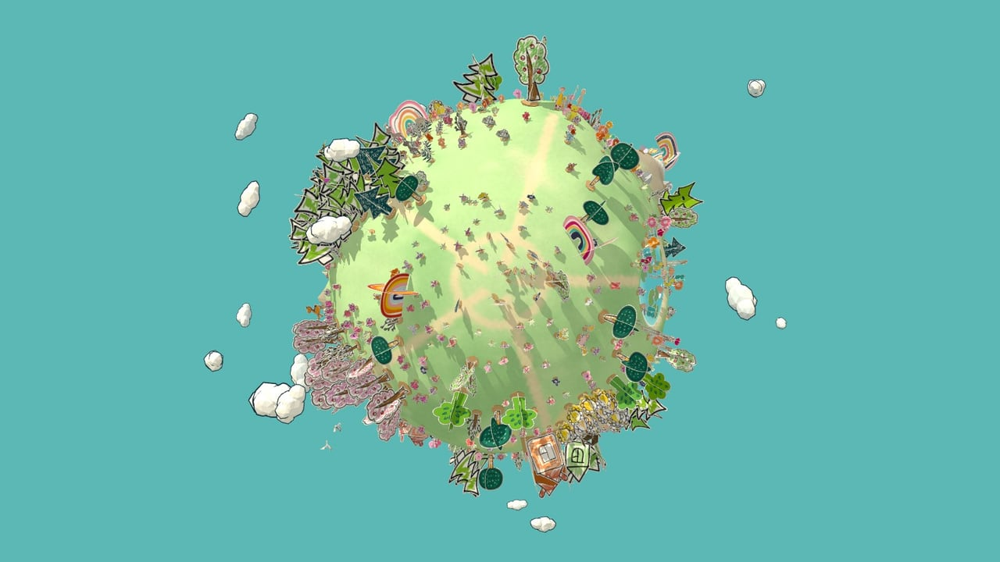
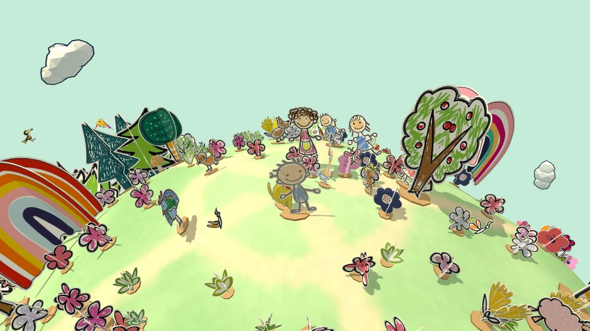
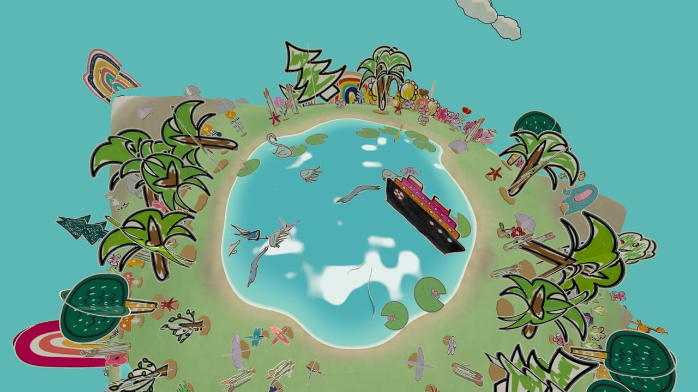
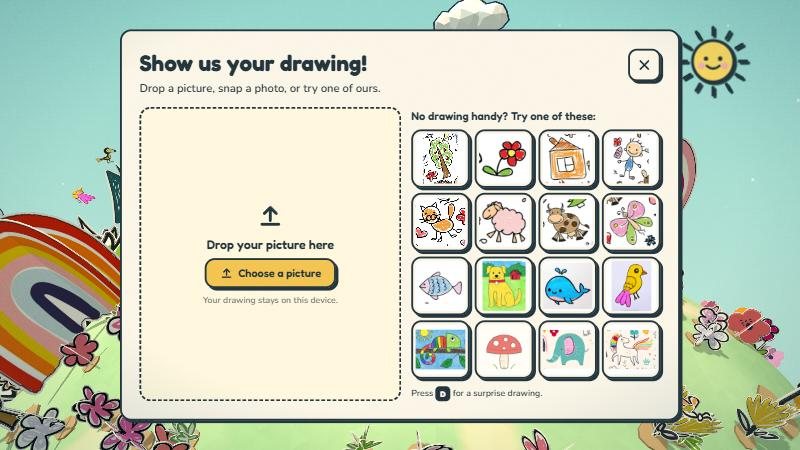
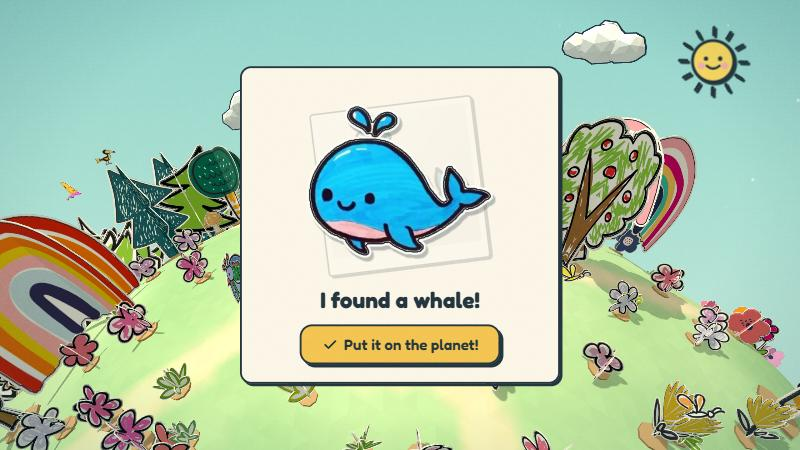
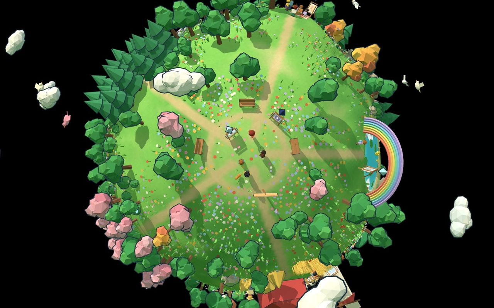
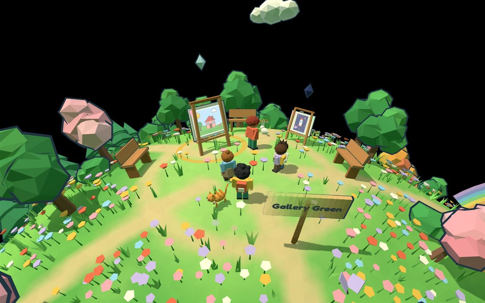
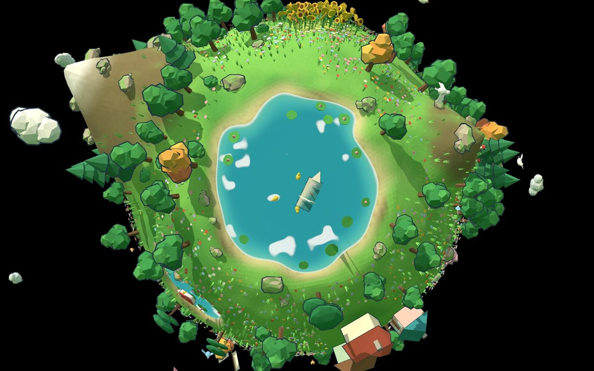

# Art Gallery - Globe Version

**Doodle Planet** is a tiny planet where kids' drawings come to life. There are two planets, and you pick one on the title screen:

- **Toy Globe**: a low-poly planet where every drawing gets its own easel. Upload a drawing, drag its easel anywhere on the globe, walk up to it, open the full picture and stick notes on it.
- **Paper Globe**: the same planet, but everything on it is a real drawing cut out of paper and standing up like a paper-craft diorama. Every tree, flower, house, animal and person is a kid's drawing. Show the planet a drawing, an "AI" finds the thing in it and cuts it out, and it drops out of the sky next to you and comes alive: the tree plants itself, the cat walks off, the fish dives into the nearest pond.

Both run in the browser, nothing leaves the device, and each keeps its own saved state in `localStorage`.



| Walking on the Paper Globe | The big lake |
|---|---|
|  |  |

| Pick a drawing | The "AI" finds what is in it |
|---|---|
|  |  |

The Toy Globe:



| Walking around | The big lake |
|---|---|
|  |  |

## Run it

Needs Node 20.19+ or 22.12+.

```bash
npm install
npm run dev
```

To build and serve the production version: `npm run build && npm run preview`.

## How to play

| Do | How |
|---|---|
| Walk | W A S D, arrow keys, tap or click the ground, touch stick |
| Look around, zoom | drag, wheel or pinch |
| See a drawing | stand next to it and press E, or click or tap it (the Toy Globe: an easel; the Paper Globe: anything) |
| Move something | press and drag it: an easel on the Toy Globe, any tree, animal, house or person on the Paper Globe |
| Add a note (Toy Globe) | open a drawing, write, pick a color, "Stick it!" |
| Add a drawing (Paper Globe) | the plus button, then pick a demo drawing or one of your own |
| Planet view | G or the globe button |

Page switches: `?globe=paper` or `?globe=toy` (pick the planet), `?lite` (half the content, no shadows, easier on slow devices), `?screen=world` (skip the intro), `?fresh` (forget what was saved on that planet), `?sheet` (the Paper Globe's cut-out library on one page, with outlines and feet drawn on).

## Adding a drawing

**Toy Globe.** Pick a file, drop one on the page, use the camera button on a touch device, or tap one of the ten sample drawings. Then give it a name, say who drew it and write a short story. Photos keep their rotation, are shrunk to 800 px and get a four-color palette. Uploads are stored as JPEGs, so about 20 fit in the browser's `localStorage`.

**Paper Globe.** Pick a file, drop one, or tap one of the 16 demo drawings (one drawing, one thing: a tree, a cat, a dog, a fish, a flower, a person, a house, a bird, a butterfly, a mushroom, a sheep and so on). There is nothing to fill in. A short "AI is looking at your drawing" show plays (scanning lines, sparkles, scissors snipping around the outline, then "I found a cat!"), and the cut-out falls from the sky next to you with a star burst. Tap anything to see its drawing big, with its name. Things you added can be taken down again from that view.

### The AI is a stand-in

Nothing looks at the picture. `src/paper/ai.ts` has one function, `extractElements(image) => Promise<Element[]>`, that a real vision model could replace without touching the screens. Today it picks from a prepared library of 138 cut-outs: a demo-shelf picture gives the thing it is a picture of; any other picture is matched by a word in its file name (`my_cat.png` gives a cat); otherwise it is a fixed pick based on the picture itself, so the same picture always gives the same thing.

### What the planet is made of

Each cut-out is a webp in `public/paper` with a black outline and a thin white paper border, listed in `src/paper/library.gen.ts` with its kind. `src/paper/kinds.ts` is the data table behind everything: a kind says what it is made of (two or three cards crossed like a plant, four cards and a folded roof for a house, a single card for an animal), how it moves (`static`, `walker2` for people, `walker4` for animals, `bird`, `insect`, `fish`, `floater`) and how big it is. A new kind is one line.

The cut-outs are made by a one-off script: `npm run cutouts` (it installs `sharp` into `scripts/` on first use and needs the source pictures in `dist/references/pics`). `PLAN-PAPER.md` explains the pipeline.

## Built with

Vite, React 19, TypeScript, three.js with react-three-fiber and drei, Zustand (saved to `localStorage`), Tailwind v4 plus hand-written "sticker" CSS, and framer-motion. Fonts are Fredoka, Nunito and Caveat through Fontsource.

There are no 3D model files. On the Toy Globe, trees, buildings, people and animals are built in code (`src/lib/kit.ts`) from flat-shaded, vertex-colored parts with dark outlines. On the Paper Globe, every cut-out is drawn by one shared shader that bends and sways the paper (instanced, one draw call per cut-out), so a planet with about 900 pieces of paper stays smooth.

## Where things live

| Folder | What is in it |
|---|---|
| `src/world` | the planet, terrain, regions, camera rig, collisions, spot finding, and the switch between the two globes (`variants.ts`) |
| `src/entities` | Toy Globe easels, people, animals, the walker, the kid, easel dragging, and the movement hook both kids share |
| `src/paper` | the Paper Globe: kinds table, cut-out library, card geometry and shader, layout by region, creatures and their paper motion, the fake AI, spawning, dragging, the picture view |
| `src/ui` | HUD, picture view with notes, panels, labels |
| `src/screens` | landing, upload, processing |
| `src/lib` | noise, sphere math, the low-poly kit, image processing |
| `public/doodles` | six original neighbor drawings that are on the Toy Globe from the start |
| `public/samples` | the ten sample drawings on the Toy Globe's upload shelf |
| `public/paper` | the 138 cut-outs, and `raw/` with the 16 demo drawings they came from |
| `public/doodles-paper` | eight original crayon-style doodles (rocks, mushrooms, lily pads, reeds, two fish) |
| `scripts` | the cut-out script and its manifest |

## Notes

- **The pictures are for the hackathon demo.** The ten drawings in `public/samples`, the 138 cut-outs in `public/paper` and the 16 pictures in `public/paper/raw` were made from pictures supplied for the hackathon (Adobe Stock and similar). Replace them with artwork you have the rights to before the project is shared or released publicly. The six doodles in `public/doodles` and the eight in `public/doodles-paper` are original.
- `dist/` is not in git. The style reference videos and source pictures live in `dist/references` on the author's machine, and `npm run build` keeps that folder instead of wiping it.
- Checked in one browser at desktop and phone widths. Not tried on a real touch device or in other browsers yet.
- [STATUS.md](STATUS.md) lists what works and the rough edges. [PLAN.md](PLAN.md) is the plan for the Toy Globe and [PLAN-PAPER.md](PLAN-PAPER.md) the plan for the Paper Globe.
- Round 1 of the project was a paper-craft graveyard diorama, "The Afterlife of Darlings". It is the git history up to commit `b17a721`.
